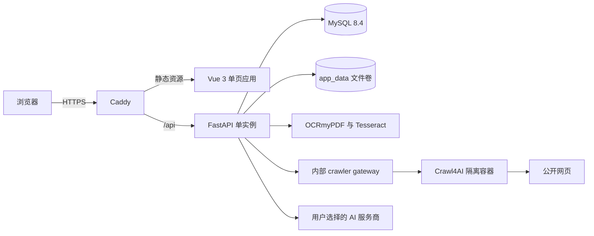

# iKnowread

> 自托管的文档阅读与知识沉淀平台。你可以在自己的服务器上阅读 PDF、DOCX、Markdown 和网页内容，使用 AI 解释选中文字，并把结果保存为高亮或笔记。

iKnowread 使用 Vue 3 构建浏览器端阅读器，使用 FastAPI 提供认证、文档、笔记和 AI 接口，使用 MySQL 保存结构化数据。生产部署由 Docker Compose 管理，并通过 Caddy 自动提供 HTTPS。

**在线体验：** [https://iknowread.site](https://iknowread.site)

## 目录

- [你可以用它做什么](#你可以用它做什么)
- [快速开始：Docker 部署](#快速开始docker-部署)
- [首次使用](#首次使用)
- [本地开发](#本地开发)
- [系统架构](#系统架构)
- [功能模块](#功能模块)
- [配置参考](#配置参考)
- [目录结构](#目录结构)
- [测试与发布检查](#测试与发布检查)
- [备份、更新与恢复](#备份更新与恢复)
- [安全与运行边界](#安全与运行边界)
- [常见问题](#常见问题)
- [版本与文档基线](#版本与文档基线)

## 你可以用它做什么

- 上传并在线阅读 PDF、DOCX 和 Markdown 文档。
- 把公开网页异步提取为 Markdown，加入个人文档库。
- 对扫描版 PDF 执行 OCR，生成可搜索、可选择文字的派生版本。
- 在文档内搜索，自动保存阅读进度，并在下次打开时继续阅读。
- 选中文字后调用你配置的大模型进行解释。
- 将选中文字保存为高亮、备注或笔记，并从笔记定位回原文。
- 按关键词或来源文档管理笔记，并导出 Markdown。
- 使用多轮智能助手进行通用问答。
- 由管理员管理账号、公告和只读体验账号。

> [!IMPORTANT]
> 文档、笔记、高亮和阅读进度保存在你的 MySQL 与文件卷中。使用 AI 功能时，选中文字或聊天内容会发送给你选择的大模型服务商；请根据数据敏感等级决定是否启用该功能。

## 快速开始：Docker 部署

完成本节后，你将得到一个由 MySQL、FastAPI、Vue 和 Caddy 组成的 HTTPS 服务。

### 1. 准备环境

你需要：

- 一台安装了 Docker Engine 与 Docker Compose v2 的服务器；
- Python 3，用于生成部署配置；
- 一个已经解析到服务器公网 IP 的域名；
- 对外开放 TCP 80 和 443 端口；
- 建议至少 4 vCPU、4 GB 内存和充足的文档存储空间。

生产部署主要面向 Ubuntu 24.04。其他系统可参考[通用 Docker 部署教程](<docs/iKnowread通用Docker部署教程(Ubuntu-Windows-macOS).md>)。

### 2. 生成部署配置

进入项目根目录，执行：

```bash
python3 deploy/init-env.py read.example.com you@example.com
```

将 `read.example.com` 和邮箱替换为你的真实信息。脚本会在项目根目录创建权限为 `0600` 的 `.env`，其中包含数据库密码、会话密钥和爬虫令牌。

脚本不会覆盖已有 `.env`。升级现有部署时，请保留原文件，不要重新生成密钥。

### 3. 启动核心服务

```bash
docker compose up -d --build
docker compose ps
```

核心服务包括：

| 服务 | 职责 |
|------|------|
| `db` | MySQL 8.4，保存账号、文档元数据、笔记、高亮和任务状态 |
| `backend` | FastAPI API、迁移、OCR/任务调度和权限校验 |
| `web` | Vue 静态资源、Caddy HTTPS 和 `/api` 反向代理 |
| `app-data-init` | 一次性初始化数据卷，并在安全条件满足时迁移旧文件 |

检查服务是否就绪：

```bash
curl -fsS https://read.example.com/api/ready
```

成功时会返回类似结果：

```json
{"code":"200","msg":"请求成功","data":{"status":"ready"}}
```

### 4. 获取初始管理员密码

全新数据库没有管理员时，后端会创建账号 `admin`，并生成一次性随机密码：

```bash
docker compose exec backend cat /app/data/.initial-admin-password
```

打开 `https://read.example.com`，选择管理员身份并登录。管理员首次成功登录后，一次性密码文件会自动删除。随后请从右上角账号菜单进入“修改密码”。

### 5. 按需启用可选能力

#### 网页收藏

编辑项目根目录 `.env`：

```dotenv
CRAWLER_ENABLED=true
WEB_IMPORT_WORKERS=1
```

然后启动带隔离爬虫的服务组：

```bash
docker compose --profile web-import up -d --build
docker compose --profile web-import ps
```

生产 Compose 使用根目录 `.env` 中由初始化脚本生成的 `CRAWL4AI_API_TOKEN`。不要把该令牌提交到 Git。

#### 扫描版 PDF OCR

生产后端镜像已经包含 OCRmyPDF、Tesseract 中英文语言包和 PDF 运行依赖。编辑根目录 `.env`：

```dotenv
OCR_ENABLED=true
```

然后重建并重启后端：

```bash
docker compose up -d --build backend
```

OCR 会消耗较多 CPU、内存和临时磁盘。建议先用真实扫描件验证容量，再在生产环境开启。

更完整的服务器准备和故障排查见 [Ubuntu 24.04 Docker 部署教程](docs/Ubuntu-24.04-Docker部署教程.md)。

## 首次使用

登录后，按下面的顺序可以最快跑通核心流程。

### 1. 上传文档

进入“我的文档”，拖入 PDF、DOCX 或 Markdown 文件。

- PDF、DOCX 最大 50 MB；
- Markdown 最大 5 MB；
- PDF 最多 1,000 页；
- DOCX 会检查 ZIP 条目数和解压后体积，防止异常压缩包耗尽资源。

上传后的处理状态会显示在文档列表中。普通文本 PDF 可以直接阅读；扫描 PDF 在 OCR 开启时进入后台识别队列。

### 2. 阅读和搜索

进入“在线阅读”，从左侧选择文档：

- PDF 支持分页阅读、连续阅读、缩放和页内文字搜索；
- DOCX 与 Markdown 使用连续阅读模式；
- 阅读进度按文档内容版本保存；
- PDF.js 与 DOCX 渲染器按文档格式动态加载，不会进入普通页面的初始包体。

### 3. 配置 AI

进入“API配置”，新建并测试一份配置，然后将其设为启用状态。当前代码支持：

- DeepSeek；
- 智谱 GLM；
- Xiaomi MiMo；
- 阿里云百炼。

系统只允许保存这些服务商的官方 HTTPS 接口地址。API Key 使用 Fernet 加密后存入数据库，读取接口不会返回明文。

### 4. 划词解释并沉淀知识

在阅读器中选择文字后，你可以：

1. 请求当前启用模型解释文字；
2. 将选区保存为持久化高亮并填写备注；
3. 将解释保存到“我的笔记”；
4. 从笔记或高亮重新定位原文。

高亮和笔记绑定文档内容版本。文档内容版本变化后，系统不会把旧定位错误套用到新内容。

## 本地开发

### 环境要求

| 工具 | 建议版本 | 用途 |
|------|----------|------|
| Python | 3.12 | FastAPI 后端和工具脚本 |
| Node.js | 20.19+ 或 22.12+ | Vite 前端；生产镜像使用 Node 24 |
| npm | 与 Node.js 配套 | 使用 `package-lock.json` 安装前端依赖 |
| MySQL | 8.x | 本地数据库；生产镜像固定为 MySQL 8.4 |
| OCRmyPDF / Tesseract | 可选 | 仅本地启用 OCR 时需要 |
| Docker Compose v2 | 可选 | 启动本地 Crawl4AI 或执行发布检查 |

### 1. 配置后端

```bash
cd fastapi-app
python3.12 -m venv .venv
source .venv/bin/activate
python -m pip install -r requirements.txt
cp .env.example .env
```

Windows PowerShell 激活虚拟环境时使用：

```powershell
.venv\Scripts\Activate.ps1
```

至少检查并修改 `fastapi-app/.env` 中的以下内容：

```dotenv
DEBUG=true
DB_HOST=127.0.0.1
DB_PORT=3306
DB_USER=root
DB_PASSWORD=你的本地MySQL密码
DB_DATABASE=iknowread
DB_AUTO_CREATE=true
CORS_ORIGINS=http://localhost:5173
OCR_ENABLED=false
CRAWLER_ENABLED=false
```

> [!IMPORTANT]
> 本地通过 HTTP 访问时必须设置 `DEBUG=true`。否则会话 Cookie 带有 `Secure` 属性，浏览器不会在 HTTP 请求中发送它，表现为“登录成功后又回到登录页”。生产环境必须使用 `DEBUG=false`。

`DB_AUTO_CREATE=true` 要求 `DB_USER` 有创建数据库的权限。如果你使用权限受限的数据库账号，请先手动创建 `iknowread` 数据库，再将该选项改为 `false`。

### 2. 启动后端

确保 MySQL 已运行，然后在 `fastapi-app` 目录执行：

```bash
python -m uvicorn main:app --reload --host 127.0.0.1 --port 9090
```

启动过程会自动执行版本化数据库迁移。后端地址为 `http://127.0.0.1:9090`，本地 OpenAPI 页面为 `http://127.0.0.1:9090/docs`。

本地初始管理员密码保存在：

```bash
cat data/.initial-admin-password
```

### 3. 启动前端

打开新终端：

```bash
cd vue
npm ci
npm run dev
```

访问 `http://localhost:5173`。Vite 会把 `/api` 请求代理到 `http://localhost:9090`。

### 4. 本地启用网页收藏（可选）

在 `fastapi-app/.env` 中设置：

```dotenv
CRAWLER_ENABLED=true
CRAWLER_BASE_URL=http://127.0.0.1:11235
CRAWLER_API_TOKEN=使用强随机值
```

可用下面的命令生成令牌：

```bash
openssl rand -hex 32
```

回到项目根目录启动本地 crawler：

```bash
docker compose --env-file fastapi-app/.env -f compose.crawler-dev.yaml up -d --build
docker compose --env-file fastapi-app/.env -f compose.crawler-dev.yaml ps
```

修改后端 `.env` 后需要重启 FastAPI 进程，因为配置只在进程启动时读取。

停止 crawler：

```bash
docker compose --env-file fastapi-app/.env -f compose.crawler-dev.yaml stop
```

### 5. 本地启用 OCR（可选）

macOS：

```bash
brew install ocrmypdf tesseract-lang
```

Ubuntu / Debian：

```bash
sudo apt-get update
sudo apt-get install -y ocrmypdf tesseract-ocr-eng tesseract-ocr-chi-sim
```

确认命令和语言包可用：

```bash
ocrmypdf --version
tesseract --list-langs
```

然后在 `fastapi-app/.env` 中设置 `OCR_ENABLED=true` 并重启后端。

## 系统架构



生产环境中的数据库网络、后端到 crawler 的 API 网络和 crawler 控制网络彼此隔离。只有 crawler 容器接入出站网络；它不挂载数据库或应用文件卷。

### 一次文档阅读请求如何流转

1. 浏览器通过 Caddy 请求 `/api/documents`。
2. FastAPI 从 HttpOnly 会话 Cookie 识别账号，并按账号过滤数据。
3. 文档元数据来自 MySQL，文件内容通过存储抽象从 `app_data` 读取。
4. 浏览器按格式懒加载 PDF.js 或 docx-preview；Markdown 会先经过安全清理再渲染。
5. 阅读进度、高亮和笔记通过 API 写回 MySQL。

### 核心设计

- **账号级数据隔离**：文档、笔记、高亮、AI 配置和阅读进度都从服务端会话确定账号，客户端不能指定另一个账号读取数据。
- **内容版本协议**：文档使用不可复用的 `content_version`。高亮、笔记定位和阅读进度绑定内容版本，避免 OCR 或内容变化后定位错位。
- **统一来源锚点**：PDF 使用页级范围，DOCX/Markdown 使用文档级范围；定位同时保存字符偏移、精确引文和上下文。
- **可恢复删除**：普通删除只设置回收站状态。彻底删除先暂存文件，再提交数据库事务；后台存储对账任务处理异常中断留下的状态。
- **异步重任务**：OCR 和网页抓取使用持久化任务状态。页面轮询只负责展示，服务重启后可以恢复未完成任务。
- **浏览器端渲染**：后端只提供经过权限校验的内容，PDF/DOCX 的主要排版工作在浏览器完成，减轻服务端渲染压力。
- **单后端实例**：上传门禁、AI 并发控制和部分任务协调依赖进程内状态。后端通过 MySQL `GET_LOCK` 强制只允许一个实例运行。
- **版本化迁移**：后端启动时按顺序执行迁移，并校验已执行迁移的校验和；不要修改已经发布的历史迁移文件。

### 技术选型

| 层级 | 技术 | 选择原因 |
|------|------|----------|
| 前端 | Vue 3、Vue Router、Vite 8 | 组件化 SPA、路由懒加载和快速构建 |
| UI | Element Plus | 表单、表格、对话框和状态反馈 |
| 文档渲染 | PDF.js、docx-preview、markdown-it、DOMPurify | 在浏览器渲染三种文档格式，并清理不可信 HTML |
| 后端 | FastAPI、Pydantic | 异步 API、严格请求校验和 OpenAPI |
| 数据访问 | Tortoise ORM、aiomysql | 异步 MySQL 访问和事务支持 |
| 数据库 | MySQL 8.4 | 持久化业务数据、迁移账本和运行锁 |
| 入口网关 | Caddy | 自动 HTTPS、静态资源服务、安全响应头和 API 反向代理 |
| OCR | OCRmyPDF、Tesseract、pypdfium2 | 为扫描 PDF 生成隐藏文字层，并限制异常页面资源消耗 |
| 网页提取 | Crawl4AI | 在独立容器中提取公开网页，避免爬虫直接访问核心数据 |
| 部署 | Docker Compose | 固定镜像、健康检查、资源限制和持久卷管理 |

## 功能模块

| 模块 | 页面入口 | 职责与使用方式 |
|------|----------|----------------|
| 系统首页 | `/manager/home` | 查看文档、笔记、最近阅读和处理任务摘要；按文件名搜索文档；快速进入上传、阅读、笔记或助手 |
| 我的文档 | `/manager/document` | 上传 PDF/DOCX/Markdown、提交网页 URL、查看处理阶段、预览文档、重试失败的 OCR、把文档移入回收站 |
| 我的回收站 | `/manager/recycle` | 恢复文档及其关联状态，或彻底删除文档；体验账号不可使用 |
| 在线阅读 | `/manager/reader` | 选择文档、搜索正文、切换 PDF 阅读模式、缩放、划词解释、管理高亮和继续上次进度 |
| 我的笔记 | `/manager/notes` | 新建或编辑笔记、搜索内容、按来源筛选、按时间或文档编排、定位原文、按文档/选择项/全部导出 Markdown |
| 智能助手 | `/manager/assistant` | 使用当前启用的 AI 配置进行多轮问答；请求最多 41 条交替消息，总字符数不超过 120,000 |
| API配置 | `/manager/api-config` | 管理多份 AI 配置、发现模型、测试连通性、切换启用项；API Key 不会在读取时回显 |
| 个人资料 | 右上角账号菜单 | 修改显示名和头像 |
| 修改密码 | 右上角账号菜单 | 修改密码后清除当前会话，需要重新登录 |
| 公告中心 | 顶栏铃铛 | 查看已发布公告、标记单条或全部已读 |
| 公告管理 | `/manager/announcements` | 管理员创建草稿、发布、重新发布、下架或删除公告 |
| 体验账号管理 | `/manager/experience` | 管理员设置公开体验密码、共享文档、AI 每日额度以及是否展示管理员高亮和笔记 |
| 用户管理 | `/manager/admin`、`/manager/user` | 管理员创建、编辑和删除管理员或普通用户账号 |

### 角色差异

| 能力 | 管理员 | 普通用户 | 体验账号 |
|------|--------|----------|----------|
| 管理自己的文档、笔记和高亮 | 是 | 是 | 否，只读共享内容 |
| 配置自己的 AI | 是 | 是 | 否，使用管理员分配的配置和每日额度 |
| 管理账号、公告、体验入口 | 是 | 否 | 否 |
| 查看共享文档 | 可管理共享范围 | 不适用 | 是，由管理员选择 |

自助注册默认关闭。需要开放时设置 `ALLOW_REGISTRATION=true`；公网环境通常建议由管理员创建账号。

## 配置参考

完整后端配置及说明位于 [`fastapi-app/.env.example`](fastapi-app/.env.example)，默认值实现位于 [`fastapi-app/app/config.py`](fastapi-app/app/config.py)。

### Docker 部署配置

以下变量位于项目根目录 `.env`：

| 变量 | 初始化值 | 说明 |
|------|----------|------|
| `DOMAIN` | 由你输入 | 对外域名，不包含协议和路径 |
| `ACME_EMAIL` | 由你输入 | Caddy 申请证书时使用的联系人邮箱 |
| `DB_PASSWORD` | 随机生成 | 应用数据库账号密码 |
| `MYSQL_ROOT_PASSWORD` | 随机生成 | MySQL root 密码，仅用于数据库管理、备份与恢复验证 |
| `AUTH_SECRET` | 随机生成 | 会话签名密钥；生产环境不能为空 |
| `CRAWL4AI_API_TOKEN` | 随机生成 | backend 与 crawler 之间的内部认证令牌 |
| `CRAWLER_ENABLED` | `false` | 是否启用网页收藏；还需要启动 `web-import` profile |
| `CRAWLER_DNS` | `1.1.1.1` | crawler 出站 DNS；必须返回真实目标地址，不能绕过 SSRF 防护 |
| `WEB_IMPORT_WORKERS` | `1` | 网页抓取 worker 数，允许 1–4 |
| `OCR_ENABLED` | `false` | 是否启动 PDF OCR 队列 |
| `ALLOW_REGISTRATION` | `false` | 是否允许普通用户自助注册 |
| `USER_STORAGE_QUOTA_BYTES` | `2147483648` | 单账号文件配额，默认 2 GiB，包含回收站文件 |
| `USER_DOCUMENT_LIMIT` | `200` | 单账号未删除文档上限 |
| `USER_TOTAL_DOCUMENT_LIMIT` | `400` | 单账号文档总数上限，包含回收站 |
| `USER_NOTE_LIMIT` | `10000` | 单账号笔记上限 |
| `USER_HIGHLIGHT_LIMIT` | `10000` | 单账号高亮总数上限 |
| `DOCUMENT_HIGHLIGHT_LIMIT` | `1000` | 单文档高亮及单次加载上限 |
| `STORAGE_MIN_FREE_BYTES` | `2147483648` | 服务器必须保留的最小可用空间 |
| `APP_TAG` | `local` | backend、web 和 crawler 的应用镜像标签 |
| `MYSQL_IMAGE_TAG` | `local` | MySQL 镜像独立标签，普通应用更新不会改变它 |

### 后端常用配置

本地开发或自定义部署还会直接使用以下后端变量：

| 变量 | 默认值 | 说明 |
|------|--------|------|
| `DEBUG` | `false` | 开发模式；影响热重载和 Cookie 的 `Secure` 属性 |
| `DB_HOST` / `DB_PORT` | `localhost` / `3306` | MySQL 地址 |
| `DB_USER` / `DB_PASSWORD` | `iknowread` / 空 | MySQL 凭据 |
| `DB_DATABASE` | `iknowread` | 数据库名，仅允许字母、数字和下划线 |
| `DB_AUTO_CREATE` | `false` | 是否在数据库不存在时自动创建 |
| `CORS_ORIGINS` | 空 | 允许携带凭据的前端源，多个值用逗号分隔；生产禁止 `*` |
| `UPLOAD_DIR` | `fastapi-app/data/files` | 文档文件目录 |
| `AI_CONFIG_KEY` | 自动生成 | AI Key 的 Fernet 密钥；默认保存到 `data/.ai-config-key` |
| `AI_GLOBAL_CONCURRENCY` | `3` | 整个后端同时执行的 AI 请求数 |
| `AI_ACCOUNT_CONCURRENCY` | `1` | 单账号 AI 请求并发数 |
| `CRAWLER_API_TOKEN` | 空 | 本地后端访问 crawler 的令牌；需要与容器内令牌一致 |
| `OCR_LANGUAGES` | `chi_sim+eng` | Tesseract 识别语言 |
| `OCR_WORKERS` | `1` | 同时处理的 OCR 文档数 |
| `OCR_TIMEOUT_SECONDS` | `900` | 单份 OCR 任务总超时，单位为秒 |
| `NOTE_EXPORT_MAX_ITEMS` | `5000` | 单次笔记导出条数上限 |
| `NOTE_EXPORT_MAX_BYTES` | `20971520` | 单次导出内容上限，默认 20 MiB |

生产 Compose 会将 `AI_CONFIG_KEY` 自动生成到持久化的 `app_data` 卷中。备份数据库时必须同时备份该卷；只恢复数据库而不恢复密钥，会导致已保存的 API Key 无法解密。

## 目录结构

```text
iKnowread/
├── compose.yaml                 # 生产服务、网络、资源限制和持久卷
├── compose.crawler-dev.yaml     # 本地 Crawl4AI 容器
├── deploy/
│   ├── Caddyfile                # HTTPS、SPA 与 /api 反向代理
│   ├── Dockerfile.*             # backend、web、MySQL、crawler 镜像
│   ├── init-env.py              # 首次部署配置生成器
│   ├── backup.sh                # 一致性备份并执行隔离恢复检查
│   ├── verify-backup.sh         # 校验归档与临时数据库恢复
│   ├── update.sh                # 健康门禁更新和失败回滚
│   └── release-check.sh         # 完整发布检查
├── fastapi-app/
│   ├── main.py                  # FastAPI 入口
│   ├── requirements.txt         # 直接依赖范围
│   ├── requirements.lock        # 生产哈希锁文件
│   ├── requirements-dev.lock    # 测试和静态检查哈希锁文件
│   ├── app/
│   │   ├── routers/             # HTTP 路由和权限入口
│   │   ├── schemas/             # Pydantic 输入输出模型
│   │   ├── services/            # 业务逻辑、任务和资源限制
│   │   ├── models/              # Tortoise ORM 模型
│   │   ├── migrations/          # 有顺序和校验和保护的数据库迁移
│   │   └── storage/             # 文件存储契约与本地实现
│   ├── scripts/                 # 合同、数据库、备份和 Docker 检查
│   └── tests/                   # 后端回归测试
├── vue/
│   ├── src/api/                 # 前端 API 封装与生成的路径合同
│   ├── src/components/          # 通用组件与阅读器子组件
│   ├── src/composables/         # 列表、OCR、渲染、高亮等状态逻辑
│   ├── src/features/            # 按业务域组织的纯逻辑
│   ├── src/views/               # 页面和管理后台入口
│   ├── tests/                   # Node.js 前端测试
│   └── vite.config.mjs          # Vite 与 Element Plus 按需加载配置
└── docs/                        # 部署与更新教程
```

### 持久化数据

| 位置 | 内容 | 是否必须备份 |
|------|------|--------------|
| `mysql_data` 卷 | 账号、文档元数据、笔记、高亮、阅读进度、任务和迁移记录 | 是 |
| `app_data` 卷 | 原始文档、OCR 派生文件、AI 加密密钥和初始密码文件 | 是 |
| `caddy_data` 卷 | 证书和 Caddy 运行数据 | 建议 |
| 根目录 `.env` | 部署域名、数据库密码和会话密钥 | 是，必须安全保存 |

## 测试与发布检查

### 后端检查

在独立虚拟环境中安装开发锁文件：

```bash
cd fastapi-app
python3.12 -m venv .venv
source .venv/bin/activate
python -m pip install --require-hashes -r requirements-dev.lock
python scripts/document_contract.py --check
python -m ruff check app tests scripts
python -m mypy
python -m pytest
```

后端测试使用内存 SQLite 覆盖业务行为；正式发布检查还会在隔离 MySQL 中验证迁移、约束和重启持久性。

### 前端检查

```bash
cd vue
npm ci
npm run check
```

`npm run check` 依次执行 ESLint、Vue 类型检查、Node.js 测试和生产构建。

### 完整发布门禁

你需要可用的 Docker、Docker Compose v2 和 Docker Scout：

```bash
bash deploy/release-check.sh
```

该脚本会：

1. 校验 Compose 配置、交付清单和发布安全脚本；
2. 构建 backend、web、db 和 crawler 四个生产镜像；
3. 在生产镜像中执行后端静态检查、测试、覆盖率和依赖审计；
4. 执行前端检查、构建和 npm 审计；
5. 验证关键二进制、Caddy 配置和真实 OCR；
6. 启动一次性隔离栈，验证 HTTPS、认证、角色、上传、笔记、高亮、迁移和重启持久性；
7. 完成后删除测试容器和一次性卷。

## 备份、更新与恢复

### 创建并验证备份

```bash
bash deploy/backup.sh
```

备份期间脚本会短暂停止后端写入，使 MySQL 导出与文件快照保持一致。输出位于 `backups/<UTC时间>/`，包含：

- `database.sql.gz`；
- `app-data.tar.gz`；
- `deployment.tar.gz`；
- `source.tar.gz`；
- `SHA256SUMS`；
- 验证成功后生成的 `COMPLETE` 标记。

脚本会自动调用隔离恢复检查。仍应把完整备份复制到服务器之外。

手动复核某份备份：

```bash
bash deploy/verify-backup.sh backups/20260101T000000Z
```

只检查归档结构和校验和、不启动临时 MySQL：

```bash
bash deploy/verify-backup.sh backups/20260101T000000Z --archive-only
```

### 更新现有部署

```bash
git pull --ff-only
bash deploy/update.sh
```

更新脚本会创建不可变的运行镜像快照和数据备份，构建唯一版本标签，验证恢复能力，切换应用容器并等待健康检查；失败时恢复到切换前的运行镜像。

普通应用更新不会重建或重启 MySQL。如果本次发布明确包含 MySQL 镜像修复，并且你已经安排维护窗口，使用：

```bash
bash deploy/update.sh --include-db
```

不要删除或覆盖现有 `.env`。数据库迁移由后端启动流程自动执行，历史迁移文件受校验和保护。

详细操作见[线上服务器代码同步更新教程](docs/iKnowread线上服务器代码同步更新教程.md)。

## 安全与运行边界

- 登录密码使用 PBKDF2-SHA256，当前实现为 600,000 次迭代。
- 登录需要一次性验证码，并对登录、注册、改密和验证码请求限速。
- 会话保存在 `HttpOnly`、`SameSite=Strict` Cookie 中，有效期为 8 小时；改密或退出会使旧会话失效。
- Caddy 设置 CSP、HSTS、禁止嵌入、MIME 嗅探防护和受限浏览器权限。
- 文档上传在写入前检查格式和结构，并受账号配额、服务器保留空间与全局并发门限制。
- AI 外呼只允许已支持服务商的官方 HTTPS 地址，不跟随重定向，并限制响应体积和并发。
- crawler 不挂载数据库或文件卷，不能访问私有地址，并通过内部网关与后端通信。
- Docker 服务使用只读根文件系统、`no-new-privileges` 和 capability drop；可写状态只放在指定卷或 tmpfs。
- 当前架构只支持一个 FastAPI worker/副本。不要修改 Uvicorn 为多 worker，也不要水平扩展 backend。
- `health` 只表示进程存活；`ready` 还会验证数据库、单实例运行锁、存储目录和启用的 OCR 依赖。

健康检查接口：

| 接口 | 用途 |
|------|------|
| `/api/health` | 进程存活检查 |
| `/api/ready` | 数据库、运行锁、文件存储和 OCR 就绪检查 |
| `/api/capabilities` | 注册、OCR、网页收藏和体验入口能力状态 |

## 常见问题

### 找不到 `.initial-admin-password`

常见原因有两个：数据库中已经存在管理员，或者管理员已经成功登录过一次。查看启动日志确认是否创建过账号：

```bash
docker compose logs --tail=200 backend
```

系统不会在已有管理员时重新生成密码。此时需要使用现有管理员账号，或通过受控的运维流程重置密码。

### 本地登录成功后立即回到登录页

确认 `fastapi-app/.env` 中设置了：

```dotenv
DEBUG=true
CORS_ORIGINS=http://localhost:5173
```

修改后重启 FastAPI。生产环境不要使用 `DEBUG=true`。

### “网页收藏服务暂不可用”

生产环境同时需要启用配置和 Compose profile：

```bash
docker compose --profile web-import ps
docker compose --profile web-import logs --tail=200 crawler crawler-gateway backend
```

确认根目录 `.env` 中 `CRAWLER_ENABLED=true`，并重新执行 `docker compose --profile web-import up -d`。

本地开发则检查 `CRAWLER_API_TOKEN` 是否与 crawler 容器中的 `CRAWL4AI_API_TOKEN` 一致。

### PDF 一直显示 OCR 未启用或识别失败

检查能力接口和后端日志：

```bash
curl -fsS https://read.example.com/api/capabilities
docker compose logs --tail=200 backend
```

确认 `OCR_ENABLED=true`，然后重建后端镜像。OCR 失败不会覆盖原 PDF；修复依赖或资源问题后，可以在“我的文档”中重试。

### 上传返回 413 或文件格式错误

确认文件满足以下边界：PDF/DOCX 不超过 50 MB，Markdown 不超过 5 MB，PDF 不超过 1,000 页。仅修改 Caddy 的请求大小限制不会绕过后端校验。

### AI 配置测试失败

依次检查：

1. API Key 是否属于所选服务商；
2. Base URL 是否为系统允许的官方 HTTPS 地址；
3. 服务器能否访问服务商；
4. 服务商账号是否有额度；
5. `docker compose logs backend` 中是否出现超时或响应过大提示。

### 恢复数据库后 API Key 无法解密

你只恢复了 MySQL，没有恢复 `app_data` 中的 `.ai-config-key`。请恢复与数据库同一备份批次的 `app-data.tar.gz`。如果密钥已经丢失，各账号必须重新填写 API Key。

### 第二个后端实例启动失败

这是预期行为。当前并发门和后台调度使用单进程状态，MySQL 运行锁会阻止第二个实例。请保持 `backend` 副本数和 Uvicorn worker 数都为 1。

### 如何查看实时状态

```bash
docker compose ps
docker compose logs -f --tail=200 backend web db
```

如果启用了网页收藏，在命令中加入 `--profile web-import` 并同时查看 `crawler` 与 `crawler-gateway`。

## 版本与文档基线

- 前端包版本：`1.0.0`；
- 数据库迁移：当前代码包含 `v001` 至 `v022`，由后端自动执行；
- README 核对基线：2026-10-27；
- 运行时锁文件：Python 使用 `requirements.lock`，前端使用 `package-lock.json`；
- 仓库当前没有独立的 `CHANGELOG.md`，升级前请审阅提交记录并执行发布门禁；
- 仓库当前没有 `LICENSE` 文件，不应在未获得项目所有者授权的情况下假定其许可条款。

当功能、环境变量、迁移或部署脚本发生变化时，应在同一变更中更新本 README，并重新验证其中的命令。
